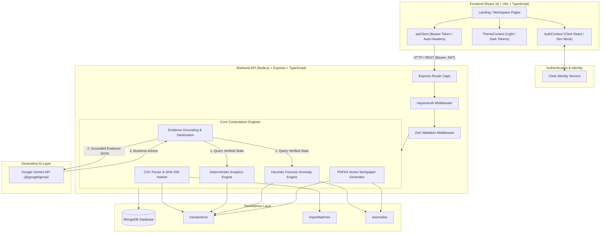

# VyaparIQ — AI Business Copilot

> **AI-Powered Financial Intelligence, Algorithmic Forensic Audit & Business Copilot for AIVORA 2K26**

VyaparIQ is an intelligent financial intelligence and audit copilot engineered for small-to-medium businesses (SMBs), accounting professionals, and finance teams. It bridges the gap between raw bank statements and actionable business decisions by combining **deterministic financial analytics**, **heuristic anomaly detection**, **counterparty relationship exploration**, and **grounded generative AI explanations** powered by Google Gemini.

---

## Table of Contents

1. [Overview](#1-overview)
2. [Problem Statement](#2-problem-statement)
3. [Key Features](#3-key-features)
4. [Application Screens & Routes](#4-application-screens--routes)
5. [Architecture](#5-architecture)
6. [Technology Stack](#6-technology-stack)
7. [Repository Structure](#7-repository-structure)
8. [Prerequisites](#8-prerequisites)
9. [Local Installation & Development](#9-local-installation--development)
10. [Environment Variables](#10-environment-variables)
11. [API Documentation](#11-api-documentation)
12. [Data Model](#12-data-model)
13. [AI & Anomaly Detection Methodology](#13-ai--anomaly-detection-methodology)
14. [Security & Privacy](#14-security--privacy)
15. [Testing & Quality Checks](#15-testing--quality-checks)
16. [Production Deployment Guide](#16-production-deployment-guide)
17. [Known Limitations](#17-known-limitations)
18. [Contributors & AIVORA 2K26](#18-contributors--aivora-2k26)
19. [Disclaimer & License](#19-disclaimer--license)

---

## 1. Overview

Small business owners and accounting professionals face recurring friction when reconciling bank statements, reviewing expense velocity, tracking duplicate vendor debits, and compiling workpapers for statutory audits.

VyaparIQ introduces a dual-layer architectural model that strictly separates **deterministic financial math** from **generative natural-language interpretation**:
- **Deterministic Math & Heuristics:** Ingested bank statement rows are parsed, categorized, mathematically aggregated, and scanned using exact statistical algorithms (Z-score thresholds, time-window duplicate matching, category multipliers, and cashflow velocity). Numbers are never generated or approximated by LLMs.
- **Evidence-Grounded AI Copilot:** When users query the Business Copilot, verified ledger aggregates and flagged anomalies are placed inside a strict evidence container. Google Gemini translates verified facts into plain-English business recommendations, answers financial questions, and suggests follow-up actions without hallucinating balances or transactions.

---

## 2. Problem Statement

1. **Tedious Manual Reconciliation:** Businesses process hundreds of transactions per month across sales, inventory, payroll, utilities, and tax debits. Identifying duplicate debits or unlinked expenses manually is time-consuming and error-prone.
2. **Delayed Cashflow Visibility:** Traditional accounting software often locks cashflow trajectory and burn-rate calculations behind complex periodic reporting menus or expensive enterprise modules.
3. **Hidden Vendor Duplicate Debits:** Accidental double debits (e.g. repeated POS or UPI charges within minutes) frequently go unnoticed until monthly or quarterly reconciliations.
4. **Audit Friction & Workpaper Preparation:** Compiling bank reconciliations, anomaly reviews, and tax preparation schedules for external auditors or tax consultants requires manual spreadsheet formatting and data aggregation.

---

## 3. Key Features

- **Financial Dashboard & KPIs:**
  - Real-time KPI quad cards: Total Inflow/Income, Total Outflow/Expenses, Net Ingested Balance, and Unresolved Anomaly Alerts.
  - Interactive 6-month rolling cashflow trajectory chart (SVG-rendered) contrasting income, expenses, and net cash generation.
  - Recent transactions ledger snippet with one-click status filters and quick actions.
- **CSV Statement Ingestion & Transaction Ledger:**
  - Drag-and-drop CSV upload supporting standard bank formats (`date`, `type`, `amount`, `category`, `description`, `reference`).
  - Cryptographic **SHA-256 batch fingerprinting** to reject duplicate file uploads with HTTP 409 Conflict (with optional `allowDuplicate=true` override).
  - Downloadable standardized sample CSV template directly from the interface or API.
  - Full transaction ledger with column sorting, paginated browsing, type filtering, and text search across descriptions and references.
- **Deterministic Analytics & Cashflow Trends:**
  - Chronological trend grouping by day or month with net cashflow calculations.
  - Granular category breakdown showing absolute spending, transaction frequencies, and percentage shares.
  - Ingested net balance semantics: distinctly marked as net ingested transaction balance (not misrepresented as verified total bank balance without an opening statement balance).
- **Rule-Based Anomaly & Risk Detection:**
  - 5 deterministic forensic detection rules:
    1. `DUPLICATE_OR_NEAR_DUPLICATE_PAYMENT`: Identical amounts within 24 hours with high description token similarity (boosted risk score for $\le 15$ min intervals).
    2. `UNUSUAL_EXPENSE_SPIKE`: Leave-one-out statistical anomaly scoring ($Z \ge 2.0$ standard deviations and multiplier $\ge 2.2\times$ baseline).
    3. `REPEATED_TRANSACTION_BURST`: High-frequency repeated transactions ($\ge 3$ within 24 hours).
    4. `HIGH_VALUE_UNRECONCILED`: Outlier debit exceeding ₹15,000 without an invoice/cheque reference.
    5. `NEGATIVE_CASHFLOW_VELOCITY`: 7-day rolling outflow $> 1.8\times$ inflow with net burn $> ₹10,000$.
  - Severity banding (`critical`, `high`, `medium`, `low`) with transparent risk scoring ($0.0 \le \text{score} \le 1.0$).
  - Reviewer workflow: Mark anomalies as resolved, add auditor/reviewer notes, and preserve resolution status idempotently across re-scans.
- **Interactive Counterparty Relationship Graph:**
  - Visual counterparty intelligence graph rendered on an interactive SVG canvas.
  - Bounded force-directed node positioning mapping the central business to vendors and customers.
  - Node inspection panel detailing transaction frequency, total volume, counterparty risk level, and directionality.
- **Evidence-Grounded Business AI Copilot:**
  - Interactive conversational interface powered by Google Gemini (`@google/genai`).
  - Strict evidence grounding: Ledger numbers, totals, and anomalies are pre-calculated by backend services and supplied inside `<verified_ledger_evidence>` boundaries.
  - Pre-computed grounded metrics, follow-up query suggestions, and actionable business directives.
  - Anti-prompt-injection sanitization, rate limiting (30 requests/minute per user), and error shielding.
- **Audit Reports & Compliance Workpapers:**
  - Three distinct report audit scopes: `Reconciliation`, `Dispute Evidence`, and `GST / Tax Preparation`.
  - On-demand server-rendered vector PDF generated via PDFKit featuring enterprise headers, KPI summaries, anomaly schedules, and statutory disclaimers.
  - Multi-format CSV data export: full reconciled transaction ledger and detected anomaly audit findings.
- **Clerk Authentication & Multi-Tenant Workspace:**
  - Industry-standard user authentication via Clerk (`@clerk/clerk-react` and `@clerk/express`).
  - Seamless route protection for internal workspace pages (`/dashboard`, `/transactions`, `/analytics`, `/findings`, `/network`, `/copilot`, `/reports`, `/settings`, `/apps`).
  - Built-in Developer Mock Mode fallback for local testing without internet access or live Clerk credentials.
- **Company Settings & Adaptive Design System:**
  - Business profile customization (business name, legal entity type, financial year selection).
  - Theme switching: Light and Dark themes implemented via semantic CSS variables and design tokens.
  - Precision Odoo-inspired application launcher (`/apps`) and collapsible sidebar with icon-rail mode.
- **Public Landing Page & Local FAQ Assistant:**
  - Polished landing page with typewriter headline micro-animation.
  - Live financial telemetry demo preview.
  - Interactive local FAQ chatbot widget providing instant answers regarding supported CSV formats, security, anomaly scoring, and report generation.

---

## 4. Application Screens & Routes

### Public Routes
| Route | Component | Description |
|---|---|---|
| `/` | `LandingPage` | Public landing page featuring product overview, interactive typewriter hero, telemetry preview, workflow steps, FAQ widget, and footer navigation. |
| `/sign-in/*` | `SignInPage` | Clerk-hosted Sign In component with Demo Mode quick-login shortcut. |
| `/sign-up/*` | `SignUpPage` | Clerk-hosted Sign Up component for new account creation. |

### Authenticated Workspace Routes (Wrapped in `ProtectedRoute` and `Layout`)
| Route | Component | Description |
|---|---|---|
| `/apps` | `AppsPage` | Application suite launcher inspired by modern ERP interfaces (Odoo/Precision Core). |
| `/dashboard` | `DashboardPage` | Executive financial health overview, KPI quad cards, 6-month cashflow trajectory, and recent transactions. |
| `/transactions` | `TransactionsPage` | CSV statement dropzone, template download, ledger search, filters, and batch status. |
| `/analytics` | `AnalyticsPage` | Income/expense trends aggregated by day or month, category breakdown charts, and percentage shares. |
| `/findings` | `FindingsPage` | Algorithmic forensic anomaly findings, risk scores, rule triggers, and resolution audit notes. |
| `/network` | `NetworkPage` | Interactive counterparty entity graph with node relationship inspector and degree statistics. |
| `/copilot` | `CopilotPage` | Grounded AI Copilot conversational interface with suggested business inquiries and verified metrics. |
| `/reports` | `ReportsPage` | Formal audit workpaper generation, scope configuration, and vector PDF / CSV export downloads. |
| `/settings` | `SettingsPage` | Business legal entity profile, financial year selector, theme toggle, and API configuration status. |

---

## 5. Architecture



### Architectural Principles:
1. **Zero Hallucinated Numbers:** All balances, category percentages, counts, and anomaly confidence scores are calculated deterministically by Node.js service modules. Google Gemini is provided only pre-calculated facts.
2. **Tenant Data Isolation:** Every database operation in MongoDB is scoped strictly to the authenticated `userId` extracted from the verified Clerk JWT. Cross-tenant data leakage is prevented at the schema query level.
3. **Graceful Offline / Demo Degradation:** When live Clerk keys or Gemini keys are not configured, the platform operates seamlessly using development mock headers (`x-mock-user-id`) and simulated fallback intelligence.

---

## 6. Technology Stack

### Frontend Dependencies (`frontend/package.json`)
- **Runtime & Build:** `react` (v18.3.1), `react-dom` (v18.3.1), `vite` (v6.0.1), `typescript` (v5.7.2).
- **Routing & Navigation:** `react-router-dom` (v6.28.0).
- **Authentication:** `@clerk/clerk-react` (v5.21.0).
- **Icons & Visuals:** `lucide-react` (v0.468.0).
- **Styling Architecture:** Precision Forensic Core Design Tokens, centralized CSS custom properties (`index.css`), responsive layouts, zero heavy UI frameworks.

### Backend Dependencies (`backend/package.json`)
- **Runtime & Web Framework:** `node` (>= 18), `express` (v4.21.2), `typescript` (v5.7.3), `tsx` (v4.19.3).
- **Database & ODM:** `mongodb`, `mongoose` (v8.9.5).
- **Authentication & Security:** `@clerk/express` (v2.1.78), `helmet` (v8.0.0), `cors` (v2.8.5).
- **Schema Validation:** `zod` (v3.24.2).
- **File Ingestion & Parsing:** `multer` (v2.4.0), `csv-parse` (v7.0.3).
- **Document Generation:** `pdfkit` (v0.20.2), `@types/pdfkit` (v0.17.6).
- **Artificial Intelligence:** `@google/genai` (v2.30.0).
- **Testing Framework:** `vitest` (v3.0.5), `supertest` (v7.0.0).

---

## 7. Repository Structure

```
vyapar-iq/
├── backend/
│   ├── src/
│   │   ├── config/
│   │   │   ├── db.ts                 # MongoDB connection lifecycle & event handlers
│   │   │   └── env.ts                # Zod-validated server environment variables
│   │   ├── middleware/
│   │   │   ├── auth.ts               # Clerk JWT verification & mock fallback
│   │   │   ├── errorHandler.ts       # Global error handler with typed error envelopes
│   │   │   └── validate.ts           # Schema validation middleware for Zod
│   │   ├── models/
│   │   │   ├── Anomaly.ts            # Mongoose schema for detected forensic anomalies
│   │   │   ├── ImportBatch.ts        # Mongoose schema for CSV batch tracking & SHA-256
│   │   │   └── Transaction.ts        # Mongoose schema for ledger transactions
│   │   ├── routes/
│   │   │   ├── analytics.routes.ts   # GET /api/analytics (summary, trends, categories)
│   │   │   ├── anomaly.routes.ts     # GET, POST, PATCH /api/anomalies
│   │   │   ├── copilot.routes.ts     # POST /api/copilot/chat
│   │   │   ├── dashboard.routes.ts   # GET /api/dashboard/summary
│   │   │   ├── health.routes.ts      # GET /api/health
│   │   │   ├── networkGraph.routes.ts# GET /api/network-graph
│   │   │   ├── reports.routes.ts     # GET /api/reports (preview, PDF, CSV)
│   │   │   ├── transaction.routes.ts # GET, POST /api/transactions
│   │   │   └── index.ts              # Route registry & /api/auth/me
│   │   ├── schemas/
│   │   │   ├── analytics.schema.ts   # Zod contracts for date range and grouping
│   │   │   ├── anomaly.schema.ts     # Zod contracts for anomaly queries and resolution
│   │   │   ├── copilot.schema.ts     # Zod contracts for Copilot chat payload
│   │   │   └── transaction.schema.ts # Zod contracts for CSV rows and queries
│   │   ├── services/
│   │   │   ├── analytics.service.ts  # Deterministic financial aggregation engine
│   │   │   ├── anomaly.service.ts    # Heuristic statistical anomaly detection engine
│   │   │   ├── copilot.service.ts    # Evidence-grounded Gemini prompt orchestration
│   │   │   ├── csv.service.ts        # Fast CSV streaming parser & sanitization
│   │   │   ├── networkGraph.service.ts# Counterparty graph node & edge generator
│   │   │   ├── pdfReport.service.ts  # Server-rendered PDFKit vector workpaper builder
│   │   │   └── transaction.service.ts# Ledger persistence & batch tracking
│   │   ├── types/
│   │   │   ├── api.types.ts          # Generic ApiResponse<T> and error envelopes
│   │   │   ├── contracts.types.ts    # Public TypeScript interfaces shared across tiers
│   │   │   └── express.d.ts          # Express Request augmentation (req.userId)
│   │   ├── app.ts                    # Express application setup, security, and routes
│   │   └── server.ts                 # HTTP server listener and graceful shutdown
│   ├── tests/
│   │   ├── fixtures/
│   │   │   └── synthetic_anomalies_test.csv # Synthetic multi-scenario test statement
│   │   ├── analytics.test.ts
│   │   ├── anomalies.test.ts
│   │   ├── auth.test.ts
│   │   ├── copilot.test.ts
│   │   ├── dashboard.test.ts
│   │   ├── health.test.ts
│   │   ├── networkGraph.test.ts
│   │   ├── reports.test.ts
│   │   ├── schemas.test.ts
│   │   └── transactions.test.ts
│   ├── .env.example
│   ├── package.json
│   └── tsconfig.json
├── frontend/
│   ├── src/
│   │   ├── components/
│   │   │   ├── auth/ProtectedRoute.tsx# Clerk / Mock protected route wrapper
│   │   │   ├── common/               # Button, Badge, Card, skiper40 animated links
│   │   │   ├── dashboard/            # CashflowChart, StatCard, TransactionTable
│   │   │   ├── landing/              # LandingTypewriter, LandingFaqChatbot
│   │   │   ├── layout/               # Layout, Navbar, Sidebar (collapsible rail)
│   │   │   └── network/              # NetworkGraphCanvas, NetworkInspector
│   │   ├── config/env.ts             # Client environment helper
│   │   ├── context/                  # AuthContext, ThemeContext, ToastContext
│   │   ├── mocks/                    # Offline mock datasets (dashboard, ledger, graph)
│   │   ├── pages/                    # 11 React router page components
│   │   ├── services/                 # Frontend API client & endpoint service modules
│   │   ├── types/                    # Shared client TypeScript types
│   │   ├── App.tsx                   # Main router hierarchy
│   │   ├── index.css                 # Precision Forensic design tokens (Dark/Light)
│   │   └── main.tsx                  # React DOM root entry
│   ├── .env.example
│   ├── package.json
│   ├── tsconfig.json
│   └── vite.config.ts
├── .gitignore
├── package.json                      # Monorepo convenience scripts
└── README.md                         # Project documentation
```

---

## 8. Prerequisites

- **Node.js**: `v18.0.0` or higher (verified on Node `v20.x` and `v24.x`).
- **npm**: `v9.0.0` or higher.
- **MongoDB**: A running MongoDB instance locally (`mongodb://localhost:27017/vyapariq`) or a cloud URI from **MongoDB Atlas**.
- **Clerk Account** *(Optional for local dev, Required for production)*: Application keys from [clerk.com](https://clerk.com).
- **Google Gemini API Key** *(Optional for local dev, Required for live AI Copilot)*: Key from [Google AI Studio](https://aistudio.google.com/).

---

## 9. Local Installation & Development

### 1. Clone the Repository
```bash
git clone https://github.com/your-username/vyapar-iq.git
cd vyapar-iq
```

### 2. Configure Backend Environment
```bash
# Navigate to backend directory
cd backend

# Copy template to active .env
cp .env.example .env

# Edit .env with your favorite editor and configure:
# MONGODB_URI=mongodb://localhost:27017/vyapariq
```

### 3. Install Backend Dependencies
```bash
npm install
```

### 4. Configure Frontend Environment
```bash
# In a separate terminal, navigate to frontend directory
cd ../frontend

# Copy template to active .env
cp .env.example .env

# Set VITE_API_BASE_URL (defaults to http://localhost:5000/api)
# Set VITE_USE_MOCK_DATA=false to connect to the live backend
```

### 5. Install Frontend Dependencies
```bash
npm install
```

### 6. Start the Local Development Servers

**Option A — Separate Terminals (Recommended):**
```bash
# Terminal 1: Backend API server (runs with tsx watch on port 5000)
cd backend
npm run dev

# Terminal 2: Frontend client (runs with Vite on port 5173)
cd frontend
npm run dev
```

**Option B — Monorepo Root Scripts:**
```bash
# From the repository root:
npm run dev:backend   # Starts backend
npm run dev:frontend  # Starts frontend
```

Access the frontend application at: **`http://localhost:5173`**  
Access the backend health check at: **`http://localhost:5000/api/health`**

---

## 10. Environment Variables

> **SECURITY NOTICE:** Never commit actual `.env` files, production credentials, database connection passwords, or API secrets into version control.

### Backend (`backend/.env`)
| Variable | Description | Default / Example | Required |
|---|---|---|---|
| `PORT` | HTTP server listener port | `5000` | No |
| `NODE_ENV` | Operational environment (`development`, `production`, `test`) | `development` | No |
| `MONGODB_URI` | MongoDB connection string (local instance or Atlas cluster) | `mongodb://localhost:27017/vyapariq` | **Yes** (for persistence) |
| `CLERK_PUBLISHABLE_KEY` | Clerk Publishable Key (`pk_test_...` or `pk_live_...`) | — | Yes (Prod Auth) |
| `CLERK_SECRET_KEY` | Clerk Secret Key (`sk_test_...` or `sk_live_...`) | — | Yes (Prod Auth) |
| `FRONTEND_URL` | Allowed CORS frontend origin | `http://localhost:5173` | **Yes** (in production) |
| `GEMINI_API_KEY` | Google Gemini API Key | — | Yes (Live AI Copilot) |
| `GEMINI_MODEL` | Gemini LLM identifier | `gemini-3.5-flash` | No |

### Frontend (`frontend/.env`)
| Variable | Description | Default / Example | Required |
|---|---|---|---|
| `VITE_API_BASE_URL` | Base URL pointing to the Express `/api` endpoints | `http://localhost:5000/api` | **Yes** |
| `VITE_CLERK_PUBLISHABLE_KEY` | Client-safe Clerk publishable key (`pk_test_...`) | — | Yes (Prod Auth) |
| `VITE_USE_MOCK_DATA` | Set to `false` to communicate with live backend | `false` | No |

---

## 11. API Documentation

All protected endpoints require either a Clerk Bearer JWT in the `Authorization` header (`Bearer <token>`) or an active development mock header (`x-mock-user-id: <user_id>`).

### System & Health
- **`GET /api/health`** *(Public)*
  - Returns service status, uptime, node environment, and MongoDB state (`connected`, `disconnected`).
- **`GET /api/auth/me`** *(Protected)*
  - Verifies user authentication and returns user identity metadata.

### Ledger & CSV Ingestion
- **`GET /api/transactions/template`** *(Public)*
  - Downloads the standardized CSV statement template with headers `date,type,amount,category,description,reference`.
- **`POST /api/transactions/import`** *(Protected)*
  - Accepts `multipart/form-data` with key `file`.
  - Calculates SHA-256 file hash to reject duplicate uploads (HTTP 409 Conflict).
  - Query parameters: `allowDuplicate=true` (optional override).
- **`GET /api/transactions`** *(Protected)*
  - Returns paginated transactions filtered by user.
  - Query parameters: `page`, `limit`, `type` (`income` \| `expense`), `category`, `startDate`, `endDate`, `search`, `sortBy`, `sortOrder`.

### Financial Analytics
- **`GET /api/analytics/summary`** *(Protected)*
  - Computes total income, total expenses, net balance, transaction counts, and calculation basis.
  - Query parameters: `startDate`, `endDate` (ISO dates `YYYY-MM-DD`).
- **`GET /api/analytics/trends`** *(Protected)*
  - Aggregates income, expense, and net trajectory over time.
  - Query parameters: `groupBy` (`day` \| `month`), `startDate`, `endDate`.
- **`GET /api/analytics/categories`** *(Protected)*
  - Aggregates totals and percentage shares by category.
  - Query parameters: `type` (`income` \| `expense` \| `all`), `startDate`, `endDate`.

### Forensic Anomaly Detection
- **`GET /api/anomalies`** *(Protected)*
  - Retrieves flagged anomaly records.
  - Query parameters: `severity` (`critical` \| `high` \| `medium` \| `low`), `type`, `isResolved` (`true` \| `false`), `startDate`, `endDate`, `recompute` (`true` \| `false`).
- **`POST /api/anomalies/detect`** *(Protected)*
  - Re-triggers on-demand deterministic anomaly scan across all user transactions.
- **`PATCH /api/anomalies/:id/resolve`** *(Protected)*
  - Updates review status (`isResolved: boolean`) and appends resolution notes.

### Business AI Copilot
- **`POST /api/copilot/chat`** *(Protected)*
  - Body: `{ "message": string, "context"?: object }`.
  - Injects pre-calculated verified metrics and returns grounded reply, citations, recommended actions, and follow-up prompts.

### Audit Reports & Exports
- **`GET /api/reports/preview`** *(Protected)*
  - Returns structured audit workpaper JSON covering financial summaries, trends, and anomaly findings.
- **`GET /api/reports/export/pdf`** *(Protected)*
  - Streams a binary vector PDF workpaper package generated dynamically with PDFKit.
- **`GET /api/reports/export/csv`** *(Protected)*
  - Streams a CSV export of all user transactions in the specified period.
- **`GET /api/reports/export/anomalies-csv`** *(Protected)*
  - Streams a CSV export of all flagged anomalies, risk scores, and affected amounts.

### Counterparty Graph & Dashboard
- **`GET /api/network-graph`** *(Protected)*
  - Returns graph payload containing entity nodes (central business, counterparties) and directed transaction edges with coordinates and metrics.
- **`GET /api/dashboard/stats`** *(Protected)*
  - Returns high-level dashboard metrics, cashflow history, and recent ledger activity.

---

## 12. Data Model

VyaparIQ utilizes MongoDB via Mongoose with strict multi-tenant schema isolation:

### 1. `Transaction` (`transactions` collection)
| Field | Type | Description |
|---|---|---|
| `userId` | String | Scoped user identifier (indexed) |
| `date` | Date | Transaction timestamp (indexed) |
| `type` | String | Enum: `'income'` or `'expense'` |
| `amount` | Number | Absolute transaction value |
| `category` | String | Category label (e.g. Sales, Rent, Inventory) |
| `description`| String | Descriptive transaction title |
| `reference` | String | Optional reference code (invoice, cheque, UPI ID) |
| `batchId` | ObjectId | Reference to the associated `ImportBatch` |

*Compound Index:* `{ userId: 1, date: -1 }` for high-performance timeline queries.

### 2. `ImportBatch` (`importbatches` collection)
| Field | Type | Description |
|---|---|---|
| `userId` | String | Scoped user identifier (indexed) |
| `filename` | String | Original client filename |
| `fileHash` | String | SHA-256 cryptographic hash of CSV buffer |
| `rowCount` | Number | Total parsed rows |
| `importedCount`| Number | Total inserted records |
| `status` | String | `'completed'` or `'failed'` |
| `createdAt` | Date | Batch ingestion timestamp |

*Compound Index:* `{ userId: 1, fileHash: 1 }` for instant idempotency checks.

### 3. `Anomaly` (`anomalies` collection)
| Field | Type | Description |
|---|---|---|
| `userId` | String | Scoped user identifier (indexed) |
| `fingerprint`| String | Deterministic SHA-256 hash preventing duplicate findings |
| `type` | String | Enum: `duplicate_payment`, `expense_spike`, `irregular_frequency`, `unusual_merchant` |
| `severity` | String | Enum: `critical`, `high`, `medium`, `low` |
| `rule` | String | Triggered heuristic rule key |
| `title` | String | Human-readable alert summary |
| `description`| String | Detailed explanation with context |
| `transactionIds`| ObjectId[]| Associated transaction records |
| `affectedAmount`| Number | Financial amount involved |
| `confidenceScore`| Number | Risk scoring metric ($0.0 \le \text{score} \le 1.0$) |
| `isResolved` | Boolean | Human review verification state |
| `resolutionNotes`| String | Auditor / reviewer commentary |

---

## 13. AI & Anomaly Detection Methodology

### Deterministic vs. Generative Separation
VyaparIQ maintains a strict firewall between math and AI:
- **Financial Calculations are 100% Deterministic:** Net balances, cash flows, rolling averages, Z-scores, and token similarity are executed entirely via deterministic TypeScript logic.
- **Generative AI is an Interpreter, not an Accountant:** Google Gemini receives structured, pre-computed evidence. It is strictly constrained from calculating balances or fabricating transaction data.

### Anomaly Rules & Heuristic Formulas

```
+--------------------------------------------------------------------------------------------------+
| Rule 1: DUPLICATE_OR_NEAR_DUPLICATE_PAYMENT                                                      |
| Score = 0.50 * TimeFactor + 0.35 * DescriptionSimilarity + 0.15 * AmountFactor                   |
| If identical amount and description overlap within 15 mins -> Score boosted to >= 0.88 (Critical) |
+--------------------------------------------------------------------------------------------------+
| Rule 2: UNUSUAL_EXPENSE_SPIKE (Leave-One-Out Category Baseline)                                  |
| Score = min(0.96, max(0.50, 0.40 * min(1, Z/4) + 0.45 * min(1, Multiplier/5) + 0.15 * Amount))    |
| Flagged when Z >= 2.0 standard deviations AND Multiplier >= 2.2x category average                 |
+--------------------------------------------------------------------------------------------------+
| Rule 3: REPEATED_TRANSACTION_BURST                                                               |
| Flagged when >= 3 identical amounts occur within 24 hours (Score = 0.72 for 3, 0.85 for >= 4)    |
+--------------------------------------------------------------------------------------------------+
| Rule 4: HIGH_VALUE_UNRECONCILED                                                                  |
| Outlier debit > Rs 15,000 without an invoice/cheque reference (Score = 0.65, Medium)             |
+--------------------------------------------------------------------------------------------------+
| Rule 5: NEGATIVE_CASHFLOW_VELOCITY                                                               |
| Rolling 7-day outflow > 1.8x inflow with net cash burn > Rs 10,000 (Score = 0.80, High)          |
+--------------------------------------------------------------------------------------------------+
```

> **STATUTORY DISCLAIMER:** Algorithmic anomaly flags and variance scores are operational indicators designed to assist human business review. They do not constitute certified statutory audit opinions, tax filings, or legal proof of fraud.

---

## 14. Security & Privacy

1. **Strict Multi-Tenant Scoping:** Every Mongoose query is scoped by `userId`. Users cannot view or modify transactions belonging to another identity.
2. **Anti-Prompt-Injection Guardrails:** Ingested ledger descriptions and references are sanitized before inclusion in AI prompts. XML/HTML tags are stripped, strings are length-capped, and system prompts instruct the model to ignore instructions embedded in transaction notes.
3. **Cryptographic Idempotency:** SHA-256 file hashing prevents accidental duplicate uploads. Anomaly fingerprints ensure re-scans preserve existing reviewer notes.
4. **Rate Limiting:** Business Copilot chat endpoints are protected by in-memory sliding-window rate limiters (30 requests/minute per user).
5. **Security Headers & CORS:** Helmet enforces HTTP security headers, and CORS restricts browser requests to configured origins (`FRONTEND_URL`).
6. **Shielded Error Responses:** Internal error stacks and database connection strings are never returned in client response envelopes.

---

## 15. Testing & Quality Checks

VyaparIQ includes an automated test suite powered by **Vitest** and **Supertest**:

```bash
# Run the complete test suite
cd backend
npm run test
```

### Verified Test Results (All 10 Suites Passing):
- **10/10 Test Suites Passed** (105 / 105 tests):
  - `health.test.ts` — Public health check & 404 handler.
  - `auth.test.ts` — Route protection and Clerk authentication middleware.
  - `schemas.test.ts` — Zod schema validation across all input boundaries.
  - `transactions.test.ts` — CSV ingestion, SHA-256 duplicate detection, ledger pagination, and filters.
  - `analytics.test.ts` — Deterministic summary, cashflow trends, and category breakdown math.
  - `anomalies.test.ts` — Heuristic detection rules, risk scoring, idempotency, and synthetic dataset scans.
  - `copilot.test.ts` — Evidence-grounded Copilot responses, rate limiting, and prompt injection defense.
  - `dashboard.test.ts` — Executive dashboard KPIs, zero-state handling, and data isolation.
  - `networkGraph.test.ts` — Counterparty node extraction and directed transaction edges.
  - `reports.test.ts` — Server-rendered PDF generation, workpaper JSON previews, and CSV exports.

### TypeScript Compilation & Linting:
- Backend: `npm run typecheck` passes with **0 errors**.
- Frontend: `npm run typecheck` passes with **0 errors**.
- Frontend Production Build: `npm run build` compiles Vite assets successfully.
- Backend Production Build: `npm run build` compiles TypeScript to `dist/` with 0 errors.

---

## 16. Production Deployment Guide

### Recommended Topology
- **Frontend:** Vercel, Netlify, or Cloudflare Pages.
- **Backend:** Render, Railway, AWS ECS, or any Node.js container platform.
- **Database:** MongoDB Atlas (M0 Free Tier or Dedicated Cluster).
- **Authentication:** Clerk Production Instance.

### 1. MongoDB Atlas Configuration
1. Create a cluster on [cloud.mongodb.com](https://cloud.mongodb.com).
2. Create a database user with read/write access.
3. Whitelist the backend hosting provider's IP addresses (or `0.0.0.0/0` with strong authentication).
4. Copy the connection string (`mongodb+srv://<user>:<password>@cluster.mongodb.net/vyapariq?retryWrites=true&w=majority`).

### 2. Clerk Production Setup
1. In the Clerk Dashboard, switch from Development to Production.
2. Add your production frontend domain (e.g. `https://vyapariq.vercel.app`) to allowed redirect origins.
3. Obtain your production **Publishable Key** (`pk_live_...`) and **Secret Key** (`sk_live_...`).

### 3. Backend Deployment (e.g., Render / Railway)
- **Root Directory:** `backend`
- **Build Command:** `npm install && npm run build`
- **Start Command:** `npm start` (or `node dist/server.js`)
- **Environment Variables:**
  ```env
  NODE_ENV=production
  PORT=5000
  MONGODB_URI=mongodb+srv://...
  CLERK_PUBLISHABLE_KEY=pk_live_...
  CLERK_SECRET_KEY=sk_live_...
  FRONTEND_URL=https://vyapariq.vercel.app
  GEMINI_API_KEY=your_gemini_api_key_here
  GEMINI_MODEL=gemini-3.5-flash
  ```

### 4. Frontend Deployment (e.g., Vercel)
- **Root Directory:** `frontend`
- **Framework Preset:** Vite
- **Build Command:** `npm run build`
- **Output Directory:** `dist`
- **Environment Variables:**
  ```env
  VITE_API_BASE_URL=https://your-backend-service.onrender.com/api
  VITE_CLERK_PUBLISHABLE_KEY=pk_live_...
  VITE_USE_MOCK_DATA=false
  ```
- **SPA Rewrite Rule (`vercel.json`):**
  ```json
  {
    "rewrites": [{ "source": "/(.*)", "destination": "/index.html" }]
  }
  ```

---

## 17. Known Limitations

1. **Byte-Level SHA-256 Ingestion Check:** Duplicate file detection relies on the SHA-256 hash of the uploaded CSV buffer. Altering a single comma, trailing space, or column header capitalization changes the hash and bypasses the file-level duplicate check (though individual row duplicates are still flagged by anomaly detection).
2. **Single-Currency Ingestion:** Ingested transactions are assumed to be in a consistent home currency (default: `INR / ₹`). Multi-currency conversion from live forex APIs is not implemented.
3. **In-Memory Rate Limiter:** The Copilot chat rate limiter (30 req/min) uses an in-memory sliding window, which resets if the server process restarts. For high-availability multi-instance clusters, a distributed Redis cache is recommended.

---

## 18. Contributors & AIVORA 2K26

Developed for **AIVORA 2K26** (AI for Business Hackathon):
- **Architecture, Backend API & Forensic AI Integration:** Engineering Team
- **UI/UX & Design Tokens:** Integrated Precision Forensic Core & Odoo-inspired Design System

---

## 19. Disclaimer & License

### Regulatory, Compliance & Review Notice
VyaparIQ provides deterministic algorithmic heuristics, duplicate checks, statistical variance scores, and generative AI summaries strictly for operational accounting reconciliation and internal business review. Algorithmic anomaly flags and cashflow velocity metrics do not constitute certified statutory audit opinions, tax filings, or legal proof of fraud. Organizations must conduct independent verification with qualified accounting professionals prior to statutory submission.

### License
This project is licensed under the **ISC License**.
